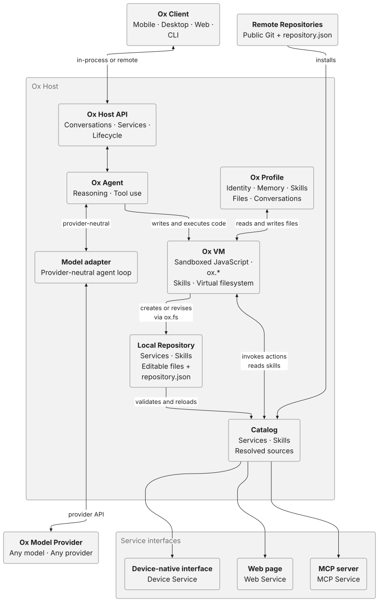

<div align="center">


<h1>OpenOx</h1>

A self-evolving agent that runs on your phone.

<h3>

[Website](https://openox.ai) · [App Store](https://apps.apple.com/us/app/ox-self-evolving-agent/id6802224502) · [Discord](https://discord.gg/Sre9DaKAAg)

</h3>

[](https://github.com/ziyzhu/openox/stargazers)
[](https://github.com/ziyzhu/openox/actions/workflows/ci.yml)

## Features

1. Turns websites into tools.
2. Feels just like ChatGPT.
3. Your device, any model.

## Ox iOS

Available to download on App Store: https://apps.apple.com/us/app/ox-self-evolving-agent/id6802224502

## Ox CLI Client

Ox CLI allows desktop clients to interact with any Ox Host such as Ox iOS.

```sh
curl -fsSL https://raw.githubusercontent.com/ziyzhu/openox/main/apps/cli/install.sh | sh
```

Only tested on MacOS and Linux.

## Architecture



- **Ox Client** — An interface that connects to an Ox Host. A Client may be a mobile app, desktop app, web app, or command-line tool. The Host binds VM execution to the selected conversation, its permissions, attached services, and virtual filesystem view.
- **Ox Host** — A process or device that opens an Ox Profile, runs the Ox VM, and supplies platform and service adapters. A Client can use an embedded Host or target a compatible Host elsewhere.
- **Ox Agent** — The reasoning and tool-using process that pursues the user’s goals using the selected model, the state in an Ox Profile, and the capabilities exposed through the Ox VM.
- **Ox Model Provider** — The language model selected by the user. OpenOx does not prescribe a model or provider; the Host adapts provider-specific APIs to the provider-neutral agent loop. API-backed subscription and OAuth accounts are supported. AI websites remain callable services, not browser-backed model providers.
- **Ox Profile** — A portable folder containing the Agent’s persistent state: its identity, memory, skills, files, and conversation history. This keeps the Ox’s state independent of a particular Client or model.
- **Ox VM** — The execution environment supplied by an Ox Host. The Agent writes and runs code inside the VM without direct access to the network, Host filesystem, or device. Instead, it uses explicit `ox.*` capabilities to interact with the Profile, services, websites, users, and device capabilities. The `ox.fs` virtual filesystem presents Profile content, skills, services, conversations, and user-granted files while preserving each source’s permissions.
- **Ox Repository** — A versioned collection of services and reusable skills described by a `repository.json` manifest. Each Ox Host manages an editable Local repository and can install compatible remote repositories. Services expose typed Actions; repository-root skill packages teach workflows that can combine several services. System, repository, and Profile skills share one catalog with explicit source selection for conflicting names.

  - **Device services** are supplied by the Host’s platform adapters and expose capabilities such as Browser.
  - **Web services** expose actions backed by websites and the user’s browser session.
  - **MCP services** expose actions provided by an MCP server.

Anyone can publish compatible web and MCP services in a public Git repository containing a `repository.json` manifest. Any compatible Host can install that repository. Device services remain part of the Host implementation.

## Distributed Evolution

Each Ox can self-evolve locally and, optionally, co-evolve with others. An Ox self-evolves through the VM, which lets it invoke an existing service while creating another one.

With an attached Browser capability, an Ox can navigate and inspect a website, perform approved interactions, and capture the evidence needed to create a reusable web service. That service becomes a set of actions the Ox can use again, combine with other services, or share through a repository.

1. The Agent invokes Browser or another attached service from the VM to gather evidence for the required capability.
2. The Agent uses `ox.fs` to write or revise the service manifest, actions, and repository-root skills in its Local Repository.
3. The Host validates each source mutation, and the Agent uses `ox.service.attach` to load or reload the service for the conversation.
4. The Agent can invoke new actions later in the same turn or in subsequent turns. New skills guide subsequent agent work.
5. Local edits persist immediately. Validate and verify the service before using it; there is no separate Save step or built-in version history.

An Ox can therefore gain and apply a capability independently, without rebuilding or updating the Host or Client. Co-evolution is optional: an Ox can publish capabilities to shared repositories and install capabilities created by other Ox.
